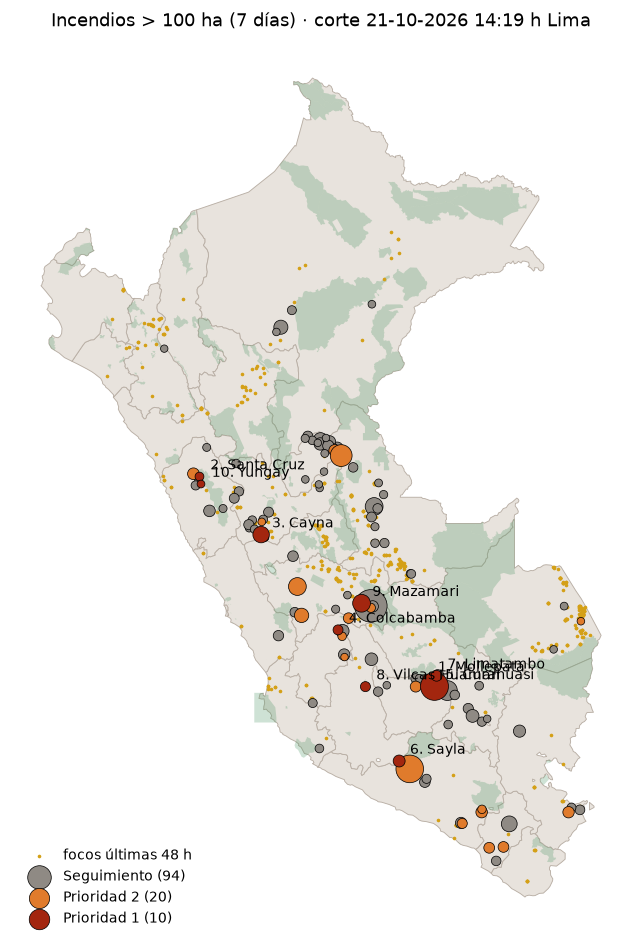
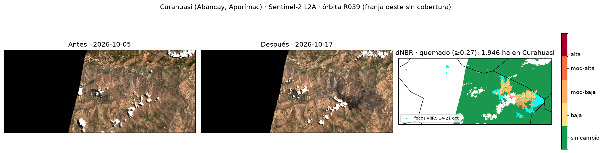

# Incendios en el Perú vistos desde el espacio · octubre 2026

**Pregunta:** ¿dónde debería actuar primero un *policy maker* esta semana, y qué tan grave es esta temporada frente a 2012–2025?

Tarea de la sesión 07 (Datos raster) · Ciencia de Datos con Python · Universidad del Pacífico · 21-oct-2026.
Todo con datos públicos, sin claves ni pagos, y corre en CPU.

**Informe interactivo:** `outputs/dashboard.html` (ábrelo en el navegador; funciona sin servidor) · versión publicada: https://claude.ai/artifact/9q2KEBDdQXhE21xEBv8tFs



## 3 hallazgos

1. **Del 1 al 19 de octubre de 2026 hubo 11 918 focos S-NPP, +80 % sobre la media 2012–2025 (z = 1,86).** Es el 2.º valor de la serie, solo detrás de 2020 (12 669), comparando la misma ventana y el mismo sensor en todos los años. **8 departamentos rompieron su récord de octubre:** Junín, Apurímac, Ayacucho, Áncash, Huancavelica, Arequipa, Lima y Tacna. Lo anómalo es la sierra: Áncash +561 %, Apurímac +475 %, Huancavelica +364 %, Arequipa +325 %. En cambio, Madre de Dios está 63 % por debajo de su media.
2. **En Curahuasi (Abancay, Apurímac) se quemaron ~1 946 ha entre el 5 y el 17 de octubre** (Sentinel-2, dNBR ≥ 0,27). El **91 % era pastizal**, el 7 % bosque y el 2 % arbustal. El número cae dentro del rango que obtuvo el profesor con otros métodos (696–2 782 ha) y cerca de su estimado comparable (1 786 ha).
3. **124 incendios con huella > 100 ha en 7 días, 25 aún activos en las últimas 48 h.** Tienen ~43 000 personas a menos de 5 km, y 15 incendios grandes están a ≤ 5 km de un área protegida. **13 ANP tienen focos dentro**; las más golpeadas son la Reserva Paisajística Subcuenca del Cotahuasi (106 focos), el ACR Imiria (32) y el PN Huascarán (24). Prioridad más alta: **Mollepata (Cusco)**, con 9 focos en 48 h y a 4,6 km del ACR Choquequirao; le siguen Santa Cruz (Áncash, dentro del PN Huascarán), Cayna (Huánuco), Colcabamba (Huancavelica) y Curahuasi. El orden es robusto: con 2 000 juegos de pesos aleatorios, los cinco primeros siguen en el top 10 en el 80–95 % de los casos, y la ρ de Spearman frente a esquemas alternativos va de 0,87 a 0,97.



## Datos y fechas

| Dato | Fuente | Fecha / versión | Tipo |
|---|---|---|---|
| Focos de calor 7 días | NASA FIRMS VIIRS (S-NPP, NOAA-20, NOAA-21), CSV «South America 7d» | 14-oct → **21-oct-2026 14:19 h Lima** | Puntos |
| Focos octubre 2026 | INPE Queimadas, mensual América del Sur, satélite NPP-375 | 1 → 20-oct-2026 14:15 h | Puntos |
| Serie histórica | NASA FIRMS, archivo anual `viirs-snpp_{año}_Peru.csv` | 2012–2025 | Puntos |
| Límites distritales | INEI vía `juaneladio/peru-geojson` | 1 834 distritos | Polígonos |
| Áreas protegidas | SERNANP geoservicios (ANP nacionales + ACR) | descarga 21-oct | Polígonos |
| Población | WorldPop 2020, 1 km | 2020 | **Raster** |
| Imágenes | Sentinel-2 L2A, Planetary Computer, órbita R039, tiles T18LYK/T18LYL | 05-oct (1,0 % nubes) y 17-oct (0,3 % nubes) | **Raster** |
| Cobertura | ESA WorldCover 10 m, Planetary Computer | 2021 | **Raster** |
| Clima | Open-Meteo, pronóstico diario | 22 → 24-oct-2026 | API |

## Método

```
src/01_focos.py          FIRMS 7d → recorte al Perú → limpieza → incendios (DBSCAN)
src/02_contexto_clima.py WorldPop a 5 km (zonal_stats) + ANP + Open-Meteo → índice de prioridad
src/03_historia.py       Octubre 2012–2026 por departamento → ¿récord?
src/04_dnbr.py           Sentinel-2 NBR/dNBR + WorldCover en Curahuasi
src/05_dashboard.py      dashboard.html + mapa estático
```

Para reproducir: `uv sync` y luego correr los cinco scripts en orden con `uv run python src/0X_*.py`. Los datos crudos van en `data/`, que no se versiona; la sección de abajo dice de dónde bajarlos.

**Decisiones**

- **Limpieza de focos:** se quitan los de confianza baja (8 613 de 9 949 quedan). También se quitan los que caen en celdas de ~1 km (más sus vecinas) donde FIRMS marcó volcán (`type 1`) o fuente fija (`type 2`) entre 2012 y 2025, lo que deja 8 521 focos.
- **Incendio:** focos a ≤ 1 km (DBSCAN haversine), cortando el cluster si hay más de 48 h sin focos. La huella es la unión de píxeles de 375 m. Se trabaja con huella > 100 ha, como el monitor del profesor.
- **Población:** suma de WorldPop en un buffer de 5 km (en UTM 18S) con `rasterstats.zonal_stats`.
- **Prioridad 0–100:** FRP total (log) 35 % + focos en 48 h 20 % + población a 5 km (log) 20 % + ANP a ≤ 5 km 10 % + clima 15 %. El clima combina humedad mínima baja, viento máximo alto y lluvia < 1 mm en 3 días. Cada componente va en rango percentil. Puestos 1–10 = Prioridad 1, 11–30 = Prioridad 2, el resto = Seguimiento.
- **Robustez:** 2 000 juegos de pesos Dirichlet centrados en los pesos base (concentración 20). Para cada incendio se reporta P(top 10) y el rango del puesto en el 90 % central de las simulaciones. Además se comparan 4 esquemas alternativos de pesos (`outputs/sensibilidad_pesos.csv`).
- **Récord:** focos S-NPP del 1 al 19 de octubre (último día completo en INPE), la misma ventana en todos los años. Para 2012–2025 se usa el archivo FIRMS con `type 0`; para 2026, INPE NPP-375. Ambos son el mismo sensor; la diferencia diaria en los días comunes fue de −19 % a +6 % (ver `03_historia.py`).
- **dNBR:** NBR = (B08 − B12) / (B08 + B12) a 20 m, **restando el offset +1000 de L2A (baseline ≥ 04.00)**; sin esa corrección el área sale 9 veces menor. Las fechas antes y después son de la misma órbita para que cubran lo mismo. La máscara SCL quita nubes, sombras, agua, nieve y píxeles sin dato. Se considera quemado si dNBR ≥ 0,27 (USGS moderada-baja).

## Limitaciones

- **Un foco de calor no es un incendio:** es un píxel caliente cuando pasa el satélite. Las nubes y el humo esconden el fuego, y los incendios chicos o rápidos pueden no verse.
- **La huella VIIRS (375 m) sobreestima el área;** para hectáreas quemadas usar el dNBR.
- **En Curahuasi,** la órbita R039 no cubre la franja oeste del recuadro (45 % del recuadro quedó enmascarado, casi todo por eso), y la imagen del 17-oct es anterior al fin del incendio, que siguió con focos hasta el 21-oct. El área real probablemente es mayor.
- **La serie compara la misma ventana (1–19 oct)**, pero INPE y FIRMS difieren día a día entre −19 % y +6 % (`outputs/calibracion_inpe_firms.csv`); el +80 % debe leerse con ese margen.
- **Los pesos del índice son decisiones de este trabajo,** no una norma oficial. No reemplaza los reportes de COEN, INDECI, SERFOR ni SERNANP.
- **Algunos nombres de ANP del servicio SERNANP vienen sin tildes** (el servicio devuelve los caracteres dañados).

## Dónde bajar los datos

```bash
# FIRMS 7 días (S-NPP, NOAA-20, NOAA-21)
https://firms.modaps.eosdis.nasa.gov/data/active_fire/suomi-npp-viirs-c2/csv/SUOMI_VIIRS_C2_South_America_7d.csv
https://firms.modaps.eosdis.nasa.gov/data/active_fire/noaa-20-viirs-c2/csv/J1_VIIRS_C2_South_America_7d.csv
https://firms.modaps.eosdis.nasa.gov/data/active_fire/noaa-21-viirs-c2/csv/J2_VIIRS_C2_South_America_7d.csv
# FIRMS anual (2012-2025) -> data/hist/snpp_{año}.csv
https://firms.modaps.eosdis.nasa.gov/data/country/viirs-snpp/{año}/viirs-snpp_{año}_Peru.csv
# INPE octubre 2026 -> data/inpe_202610.csv
https://dataserver-coids.inpe.br/queimadas/queimadas/focos/csv/mensal/America_Sul/focos_mensal_202610.csv
# Distritos -> data/distritos.geojson
https://raw.githubusercontent.com/juaneladio/peru-geojson/master/peru_distrital_simple.geojson
# WorldPop -> data/worldpop_per_2020_1km.tif
https://data.worldpop.org/GIS/Population/Global_2000_2020_1km/2020/PER/per_ppp_2020_1km_Aggregated.tif
# SERNANP (capa 0 = ANP nacionales, 2 = ACR) -> data/anp_0.geojson, data/anp_2.geojson
https://geoservicios.sernanp.gob.pe/arcgis/rest/services/servicios_ogc/peru_sernanp_0102/MapServer/{capa}/query?where=1%3D1&outFields=*&outSR=4326&maxAllowableOffset=0.002&f=geojson
# Leaflet CSS (se incrusta en el dashboard) -> data/leaflet.css
https://cdnjs.cloudflare.com/ajax/libs/leaflet/1.9.4/leaflet.min.css
```
Sentinel-2, WorldCover y Open-Meteo se leen directo desde los scripts.
