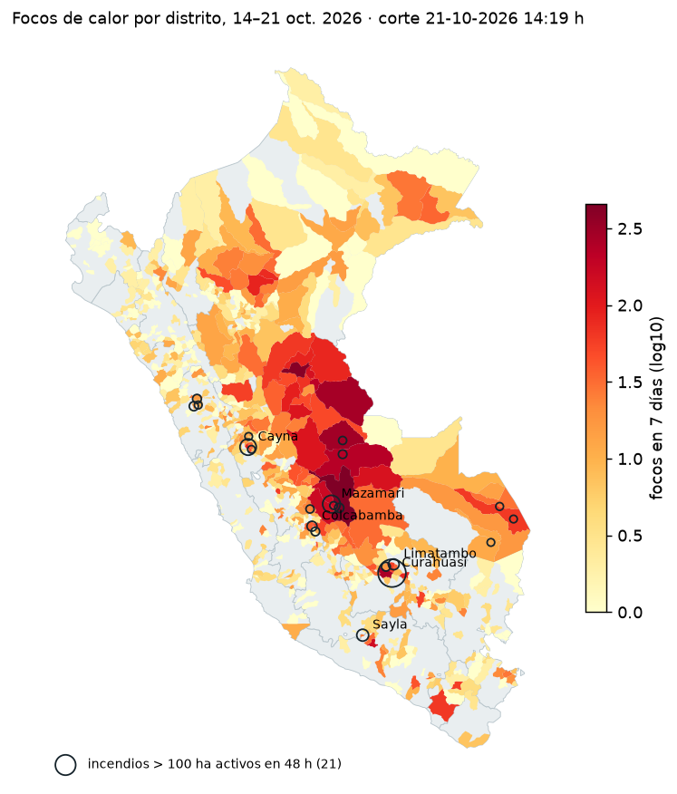

# La ola de incendios forestales de octubre de 2026 en el Perú, vista por satélite

**Preguntas:** ¿dónde arde ahora?, ¿cómo evolucionó la semana?, ¿es una temporada excepcional?, ¿cuánto se quemó?, ¿qué y a quién expone el fuego?, ¿qué condiciones se esperan en los próximos días?

Tarea de la sesión 07 (Datos raster) · Ciencia de Datos con Python · Amanda Gomez · 21-oct-2026.
Todo con datos públicos, sin claves ni pagos. **Sin índices compuestos:** cada variable se reporta medida, por separado.

**Repositorio:** https://github.com/av-gomez/incendios-peru-2026

**Informe interactivo:** `outputs/dashboard.html` (se abre en el navegador, sin servidor) · versión publicada: https://claude.ai/artifact/9q2KEBDdQXhE21xEBv8tFs



## Contexto

Entre el 4 y el 21 de octubre de 2026 el Perú enfrenta una ola de incendios forestales. Al 19 de octubre, INDECI reportaba **12 fallecidos, 832 personas afectadas y 12 incendios activos**, y señalaba como puntos críticos **Río Tambo (Junín)** y **Curahuasi (Apurímac)**, con solo 2 helibaldes disponibles en el país ([Infobae, 19 oct.](https://www.infobae.com/peru/2026/10/19/peru-registra-12-incendios-forestales-activos-en-varias-regiones-segun-indeci/); [Infobae, 21 oct.](https://www.infobae.com/peru/2026/10/21/peru-solo-cuenta-con-dos-helibaldes-para-combatir-incendios-forestales-y-espera-sumar-nuevos-equipos-recien-a-mediados-de-noviembre/)). Mongabay documentó que el fuego en Río Tambo afecta comunidades asháninka y amenaza la Reserva Comunal Asháninka ([Mongabay, 13 oct.](https://es.mongabay.com/2026/10/peru-medio-centenar-incendios-forestales-trece-regiones-extienden-territorios-indigenas/)).

## Hallazgos (corte satelital: 21-oct-2026, 14:19 h de Lima)

1. **Dónde arde ahora.**
   - En 7 días hubo **8 521 focos de calor** en **645 distritos**, 333 de ellos en las últimas 24 h.
   - **21 incendios de más de 100 ha siguen activos** (con focos en las últimas 48 h).
   - Los distritos con más focos son **Río Tambo (457), Nueva Requena (415) y Tahuania (294)**: la selva central y Ucayali concentran la actividad.
2. **Cómo evolucionó la semana.**
   - El pico fue el **16 de octubre, con 2 496 focos**. Desde el 17 la actividad cayó a entre 310 y 674 focos diarios.
   - La caída no es pareja: Ucayali, Junín y Madre de Dios siguen con focos.
3. **Es una temporada excepcional.**
   - Del 1 al 20 de octubre se registraron **12 007 focos, +74 % sobre la media 2012–2025 (z = 1,81)**. Es el 2.º valor de la serie; solo lo supera 2020 (12 845).
   - **8 departamentos superaron su máximo histórico**, la mayoría andinos: Áncash (+543 %), Apurímac (+453 %), Huancavelica (+334 %), Arequipa (+315 %), Tacna, Lima, Ayacucho y Junín.
4. **Cuánto se quemó.**
   - En **Curahuasi** se quemaron al menos **1 946 ha** entre el 5 y el 17 de octubre (Sentinel-2, dNBR ≥ 0,27).
   - El **90 % era pastizal**.
   - La cifra cae dentro del rango de 696 a 2 782 ha que dan otros métodos.
5. **Qué y a quién expone.**
   - **40 671 personas** viven a menos de 5 km de un incendio activo; la mayor exposición está en Yungay (13 014).
   - **13 áreas protegidas** tienen focos dentro; la más afectada es la Reserva Paisajística Subcuenca del Cotahuasi (106).
   - Los incendios activos arden sobre pastizal (11) y bosque (9).
6. **Próximos 3 días.**
   - 3 incendios activos tendrán humedad mínima menor a 30 %: Pueblo Libre, Curahuasi y Mollepata.
   - Ninguno cumple la regla 30-30-30, porque el viento no supera los 30 km/h.


## Datos

| Dato | Fuente | Fecha | Tipo |
|---|---|---|---|
| Focos de calor, 7 días | NASA FIRMS VIIRS (S-NPP, NOAA-20, NOAA-21) | 14 → 21-oct 14:19 h | Puntos |
| Focos de octubre 2026 | INPE Queimadas (NPP-375) | 1 → 21-oct | Puntos |
| Serie histórica | NASA FIRMS, archivo anual por país | 2012–2025 | Puntos |
| Población | WorldPop, 1 km | 2020 | **Raster** |
| Imágenes | Sentinel-2 L2A (Planetary Computer), órbita R039 | 5 y 17-oct | **Raster** |
| Cobertura | ESA WorldCover, 10 m | 2021 | **Raster** |
| Pronóstico | Open-Meteo | 22 → 24-oct | API |
| Áreas protegidas | SERNANP geoservicios | consulta 21-oct | Polígonos |
| Límites | INEI (juaneladio/peru-geojson) | 1 834 distritos | Polígonos |
| Cifras oficiales | INDECI vía prensa | 19–21 oct | Texto |

## Método

```
src/01_focos.py          FIRMS 7 días → recorte al Perú → limpieza → incendios (DBSCAN ≤ 1 km, ≤ 48 h)
src/02_contexto_clima.py Población (zonal_stats sobre WorldPop), ANP, cobertura en el punto, clima, estado;
                         focos por distrito y por departamento-día
src/03_historia.py       1 de octubre → último día completo, 2012–2026, por departamento
src/04_dnbr.py           Sentinel-2 NBR/dNBR + WorldCover en Curahuasi
src/05_dashboard.py      dashboard.html + mapa estático
```

Para reproducir: `uv sync` y correr los scripts en orden con `uv run python src/0X_*.py`.

**Decisiones**

- **Limpieza:** se quitan los focos de confianza baja y los que caen en celdas de ~1 km que FIRMS marcó como volcán o fuente fija en 2012–2025. De 9 949 focos quedan 8 521.
- **Incendio:** focos a ≤ 1 km y sin pausas de más de 48 h. La huella es la unión de píxeles de 375 m. Se reportan los de huella > 100 ha.
- **Estado:** según la última detección: focos en las últimas 24 h, hace 24–48 h, o sin focos en 48 h.
- **Por verificar:** incendios con solo detecciones diurnas, potencia mediana < 10 MW y centro en suelo desnudo o urbano (WorldCover). Son 7 en la costa desértica (Moquegua, La Joya, Marcona): pueden ser quemas agrícolas o falsas detecciones sobre suelo caliente. Se muestran, pero no se suman.
- **Sin índice compuesto:** las listas se ordenan por una sola variable medida (huella, focos en 48 h o población a 5 km), a elección del lector.
- **Serie histórica:** misma ventana y mismo sensor (S-NPP) en todos los años; 2026 viene de INPE, calibrado contra FIRMS (−19 % a +6 % diario).
- **dNBR:** NBR = (B08 − B12)/(B08 + B12) a 20 m, restando el offset +1000 de L2A (baseline ≥ 04.00). Antes y después de la misma órbita, máscara SCL y umbral 0,27 (Key y Benson, 2006).
- **Clima:** valores crudos de Open-Meteo con la regla práctica 30-30-30 como referencia visual, no como puntaje.

## Limitaciones

- **Un foco de calor no es un incendio:** es un píxel caliente al paso del satélite. Las nubes y el humo esconden el fuego.
- **Las cifras satelitales y las oficiales miden cosas distintas:** grupos de focos frente a emergencias registradas en campo.
- **La huella VIIRS sobreestima la superficie;** las hectáreas quemadas salen del dNBR.
- **En Curahuasi la órbita no cubre el borde oeste** y el incendio siguió después del 17-oct. La cifra es un mínimo.
- **WorldPop 2020 y WorldCover 2021 son anteriores a la temporada;** la población a 5 km es exposición potencial.
- **No reemplaza los reportes** de COEN, INDECI, SERFOR ni SERNANP.

## Dónde bajar los datos

```bash
# FIRMS 7 días (S-NPP, NOAA-20, NOAA-21)
https://firms.modaps.eosdis.nasa.gov/data/active_fire/suomi-npp-viirs-c2/csv/SUOMI_VIIRS_C2_South_America_7d.csv
https://firms.modaps.eosdis.nasa.gov/data/active_fire/noaa-20-viirs-c2/csv/J1_VIIRS_C2_South_America_7d.csv
https://firms.modaps.eosdis.nasa.gov/data/active_fire/noaa-21-viirs-c2/csv/J2_VIIRS_C2_South_America_7d.csv
# FIRMS anual (2012-2025) -> data/hist/snpp_{año}.csv
https://firms.modaps.eosdis.nasa.gov/data/country/viirs-snpp/{año}/viirs-snpp_{año}_Peru.csv
# INPE octubre 2026 -> data/inpe_202610.csv
https://dataserver-coids.inpe.br/queimadas/queimadas/focos/csv/mensal/America_Sul/focos_mensal_202610.csv
# Distritos -> data/distritos.geojson
https://raw.githubusercontent.com/juaneladio/peru-geojson/master/peru_distrital_simple.geojson
# WorldPop -> data/worldpop_per_2020_1km.tif
https://data.worldpop.org/GIS/Population/Global_2000_2020_1km/2020/PER/per_ppp_2020_1km_Aggregated.tif
# SERNANP (capa 0 = ANP nacionales, 2 = ACR) -> data/anp_0.geojson, data/anp_2.geojson
https://geoservicios.sernanp.gob.pe/arcgis/rest/services/servicios_ogc/peru_sernanp_0102/MapServer/{capa}/query?where=1%3D1&outFields=*&outSR=4326&maxAllowableOffset=0.002&f=geojson
# Leaflet CSS (se incrusta en el dashboard) -> data/leaflet.css
https://cdnjs.cloudflare.com/ajax/libs/leaflet/1.9.4/leaflet.min.css
```
Sentinel-2, WorldCover y Open-Meteo se leen directo desde los scripts.
